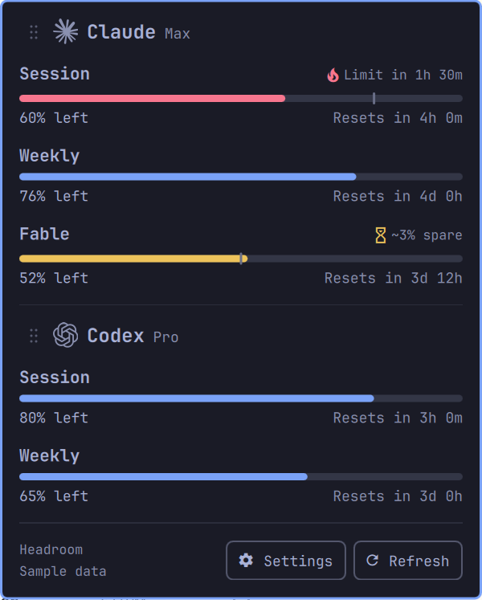
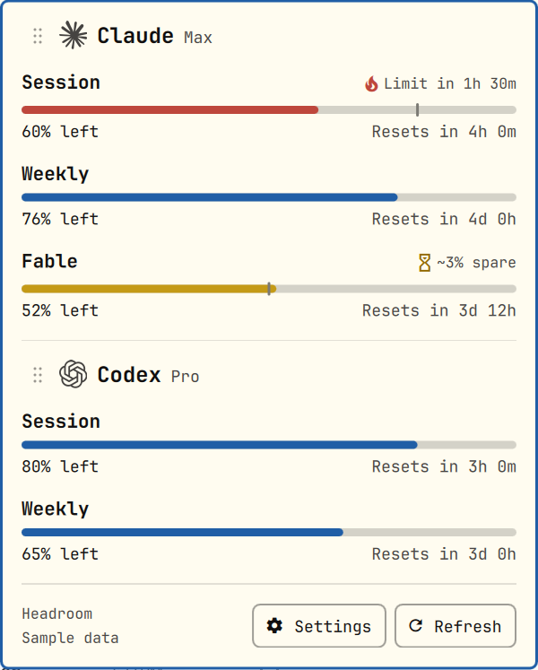

# Headroom

Claude Code and Codex weekly percentages, reset times, and usage forecasts for the Omarchy bar.

Choose either or both providers, their order, and where each appears. Headroom uses Omarchy's installed quota collectors and native panel styling that follows the active theme.

## What it shows

- Weekly percentages **remaining** for your chosen providers in the bar.
- Session, weekly, and reported model-specific quota windows in the panel.
- Reset countdowns beneath thin quota meters.
- Quiet quota rows when capacity is healthy. A yellow meter and spare-capacity note appear when the projected buffer is below 10%; a red meter and flame warn of a limit, with an exhaustion estimate when available.
- Hover a quota meter for the projected capacity at reset. Warning notes sit beside the quota title.
- Last-known percentages with a warning when a refresh cannot be verified. Unreliable data never generates a forecast.

Forecasts use average consumption since the quota window began. They are estimates of allowance consumption, not a measurement of the last few minutes' activity.

## Preview

Synthetic values; the interface follows the active Omarchy theme.

| Dark | Light |
| --- | --- |
|  |  |

## Requirements

- Omarchy with the Quattro shell and native plugin services. Tested with package `omarchy 4.0.2-1`; this is a tested baseline, not a guaranteed minimum version.
- Python 3, the core usage collector, and a signed-in CLI for each enabled provider: `omarchy-agent-usage-claude` / Claude Code or `omarchy-agent-usage-codex` / Codex.
- `qt6-5compat` for monochrome icon tinting.

## Install

Install and enable Headroom using the same command shown on the marketplace:

```sh
omarchy plugin add https://github.com/steveclarke/omarchy-headroom.git --enable
```

With your Claude Code or Codex CLI signed in, this enables allowance percentages, reset times, and usage forecasts.

Click the bar summary to open the panel. Right-click or middle-click refreshes; R or Enter refreshes inside the panel, and Escape closes it. Usage refreshes every five minutes. Repeated refresh requests within twenty seconds are coalesced.

Headroom works alongside the built-in Agents display, which adds account switching. Its collectors are core Omarchy commands, so the Agents widget does not need to run. To avoid two independent refresh loops, disable it:

```sh
omarchy plugin disable omarchy.agents
```

To restore the built-in display:

```sh
omarchy plugin remove io.github.steveclarke.headroom
omarchy plugin enable omarchy.agents
```

Update with `omarchy plugin update io.github.steveclarke.headroom`.
If an update still shows the old behavior, run `omarchy restart shell` to clear the shell's compiled QML cache.

Removing the plugin stops its workers and removes the plugin checkout. The provider CLIs, their credentials/history, and Omarchy's native usage caches remain. Headroom does not delete those shared files or restore the Agents widget automatically.

## Settings

The panel uses Omarchy's shared popup border, corner radius, font and control styles, so it follows your desktop theme.

Click **Settings** in the panel, or press **S** while it is open. Each provider occupies one draggable row with two columns:

- **Enabled** enables usage collection and the details shown when you click Headroom. Turning it off hides that provider and stops its quota worker.
- **Top bar** adds its weekly percentage to the top bar. Turning this off keeps the provider in the details. The switch is disabled while the provider is off and remembers its choice when re-enabled.

Both providers and their top-bar summaries default to on. Existing visibility choices are preserved when updating.

Drag a provider header on the main screen, or its grip in Settings, to move the whole provider section. Dropping saves the same order for the bar and quota groups. A focused grip also supports Up/Down; Escape cancels a drag. When there are no bar summaries, a compact **Headroom** entry keeps the panel and settings reachable.

Changes apply and save automatically across all monitors through Omarchy's existing widget configuration. The bar updates while settings stays open. **Done** or Escape returns to the updated details panel and keeps your changes; closing the panel also keeps them. In settings, Tab moves between controls and Space activates them. A rejected change leaves the saved selection in place and shows an error. Outside settings, the native panel navigation and refresh keys remain available.

To check the runtime and selected collector commands without reading accounts or contacting providers:

```sh
python3 ~/.config/omarchy/plugins/io.github.steveclarke.headroom/bin/headroom-collect --check-dependencies --providers claude codex
```

List only the providers you use. Missing required files produce a nonzero exit status. This checks availability, not login validity or future collector schema compatibility. Login failures and unsupported collector formats appear on the affected provider's card.

## Data access and network

Headroom delegates quota authentication to the installed Omarchy collectors. Claude's collector reads its CLI credentials and contacts `https://api.anthropic.com/api/oauth/usage`. Codex's collector runs the signed-in local Codex app-server and requests subscription limits; the installed Codex CLI owns its OpenAI connections and authentication. Headroom does not receive, store, or print credential values. Native collector credential handling, HTTP behavior, and cache writes remain upstream responsibilities.

Only normalized quota fields reach the shell; raw collector output is discarded. Helper output, runtime, strings and nesting have explicit limits.

## Current limitations

- Headroom shows only windows exported by Omarchy's collectors. A provider can legitimately have a weekly allowance without a shared session allowance; Only reported windows appear in the panel. The current Codex collector does not export its separate model-specific pools.
- Forecasts require a known window duration and a verified recent observation. Unknown windows still show their usage and reset time. A new or unused window has no meaningful burn rate yet.
- Claude can silently fall back to cached values. On Omarchy 4.5 and later, Headroom uses the collector's own freshness report for the active Claude account; on older versions it checks the native usage-cache timestamp, and a simultaneous check by another widget can briefly leave Claude marked unverified. The native CLI owns login renewal.
- There is one active account per provider. Headroom does not persist its own snapshots or support account switching/multi-account aggregation.
- Native collectors may scan local history when their caches expire, although Headroom discards those statistics and displays only quota windows.
- This proof of concept targets horizontal bars. Vertical layout is provisional.

## Development

The bundled `providers.json` registry defines provider identity, collector names and display capabilities. `Providers.js` validates preferences and orders enabled IDs. The shell creates one `Service.qml` for all monitors. It runs `bin/headroom-collect`; `Model.js` and `Pace.js` normalize display state and calculate forecasts. `BarWidget.qml` hosts the native `Panel.qml` lifecycle.

Interface conventions are recorded in [DESIGN.md](DESIGN.md); contributor guidance is in [docs/CONTRIBUTING.md](docs/CONTRIBUTING.md).

Run the checks with Node.js, Python 3, Qt 6 qmllint and Omarchy installed:

```sh
python3 bin/check
python3 tests/check-qml
python3 tests/check-drag
```

For runtime checks on an installed plugin:

```sh
omarchy-shell io.github.steveclarke.headroom status
omarchy-shell shell summon io.github.steveclarke.headroom '{}'
omarchy-shell shell hide io.github.steveclarke.headroom
```

Synthetic previews exercise forecasts, errors and empty states without provider calls. The footer always identifies sample data. Return to live mode when finished:

```sh
omarchy-shell io.github.steveclarke.headroom preview normal
omarchy-shell io.github.steveclarke.headroom preview stale
omarchy-shell io.github.steveclarke.headroom preview empty
omarchy-shell io.github.steveclarke.headroom preview ''
```

`python3 tests/check-drag --desktop` also tests main-screen dragging in an isolated native panel with synthetic data; it briefly opens a window.

Use synthetic fixtures and screenshots. Never commit credentials, account identifiers, local usage records, or machine configuration. Only fixed error categories are surfaced; raw collector output is not logged. The read-only status command reports provider preferences, state and window counts, not usage amounts.

## License

MIT. See [LICENSE](LICENSE) and [NOTICE](NOTICE) for upstream attribution.
